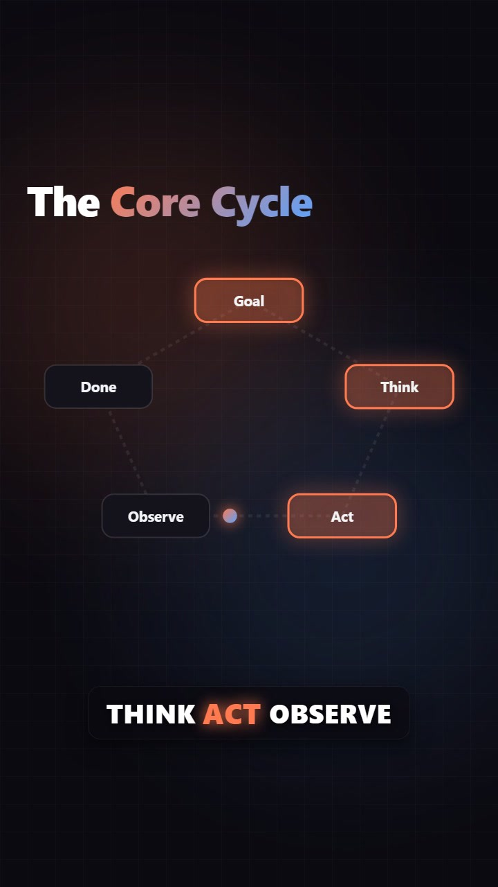
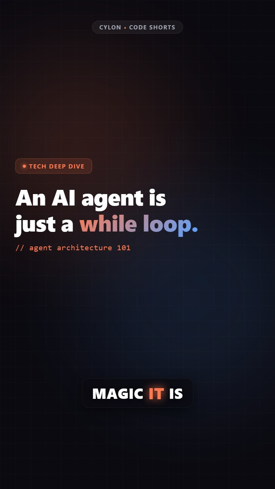
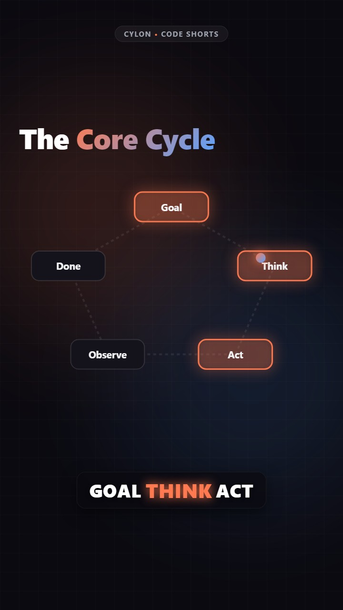
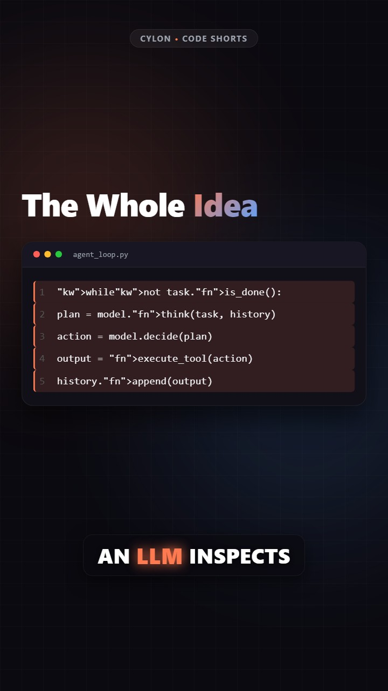
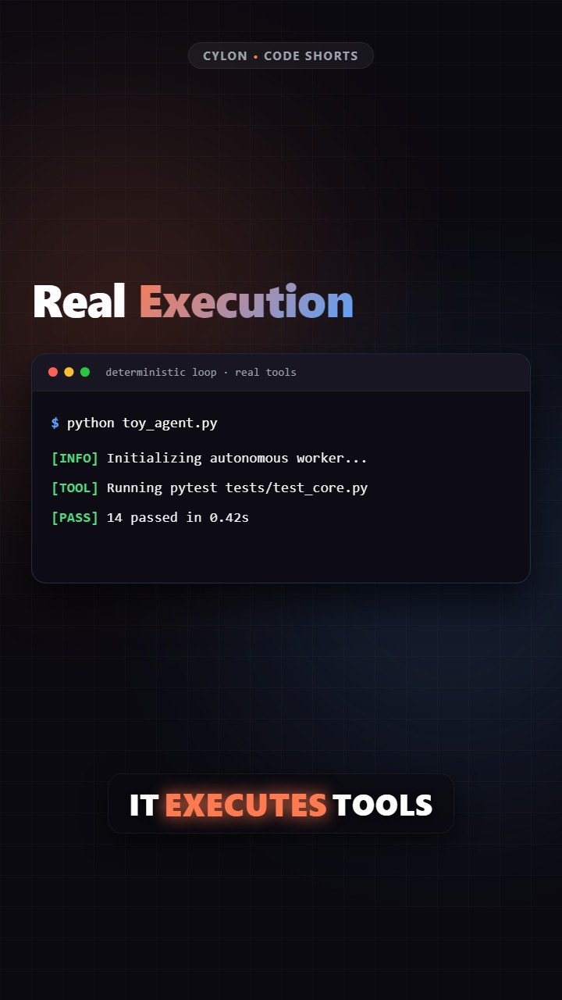
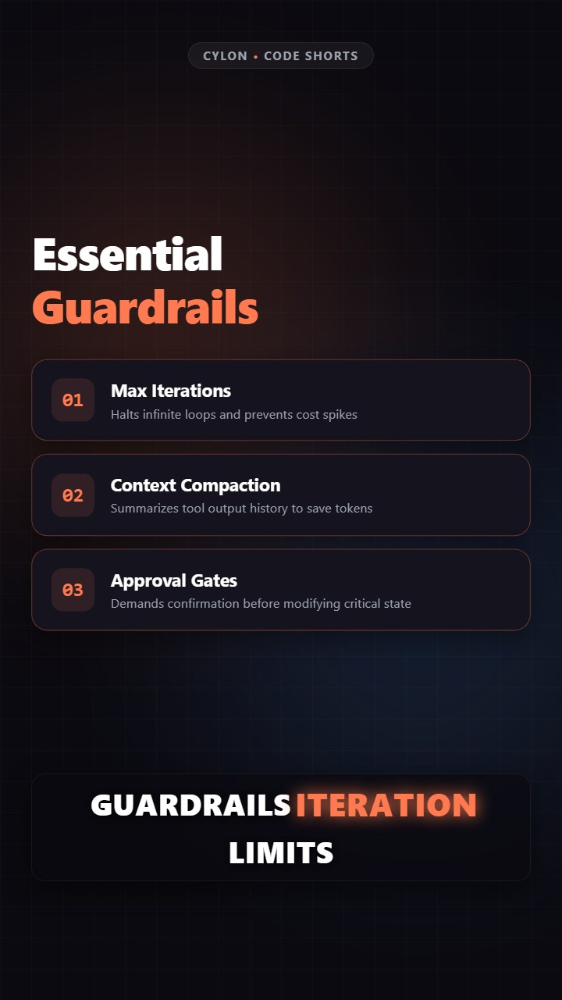
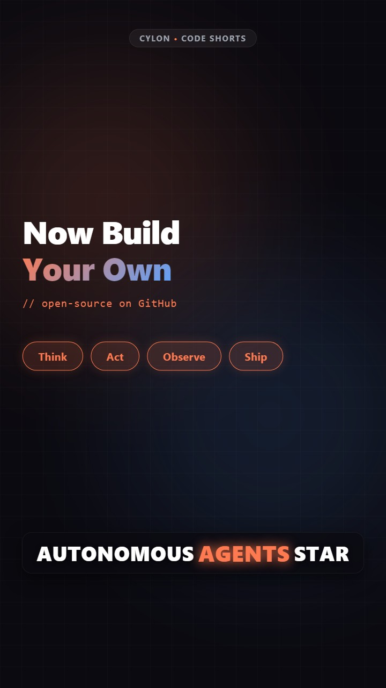
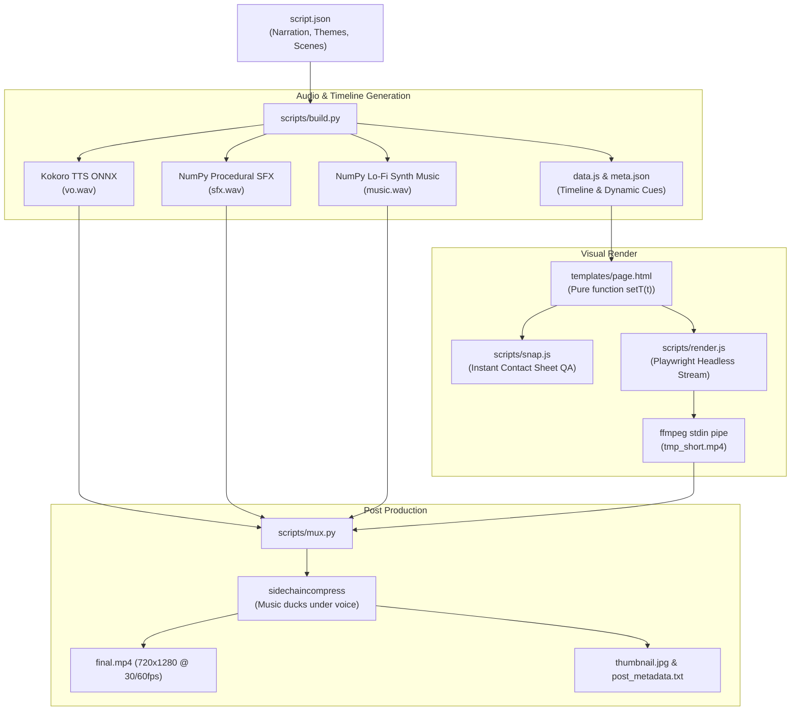

# 🎬 Code-Driven Shorts (`cylon`)

> **Turn code and declarative JSON into studio-grade vertical shorts (YouTube Shorts, Instagram Reels, TikTok) in under 60 seconds. Zero cloud API fees, zero manual editing, 100% reproducible.**

[](LICENSE)
[](https://www.python.org/downloads/)
[](https://nodejs.org/)
[](https://playwright.dev/)
[](SKILL.md)

---

## 💡 Overview

Traditional short-form video creation for developers is painfully manual: screen recording, trimming, subtitle timing, audio leveling, and finding background music.

**Code-Driven Shorts** changes this paradigm:
- 📝 **Declarative `script.json`**: Write the narration, code snippets, visual themes, and scene transitions in plain JSON.
- 🗣️ **Local Kokoro TTS**: Generates natural speech locally using Kokoro-82M ONNX with millisecond-exact sentence and caption timings.
- 🎛️ **Procedural Audio**: Synthesizes custom sound effects (whooshes, dings, code typing ticks) and ambient lo-fi pad music mathematically via NumPy—no copyrighted music, no licensing worries.
- 🎨 **Deterministic DOM Engine (`setT(t)`)**: Playwright renders every frame deterministically at 720×1280.
- 🎚️ **Automated Sidechain Ducking**: ffmpeg automatically compresses background music whenever voice narration is active.
- 🤖 **Turnkey Agent Skill**: Drop into Claude Code, Codex, Antigravity, or Cursor to let your AI assistant generate complete tech videos autonomously.

---

## 🎥 Generated Demo Short

Here is a 40-second vertical short generated 100% from [`examples/demo_agent_loop/script.json`](examples/demo_agent_loop/script.json) using local Kokoro TTS, procedural audio, and deterministic DOM rendering:

<p align="center">
  <a href="assets/demo_short.mp4">
    
    <br/>
    <b>▶️ Click to Watch Full Demo Video (40s MP4 with Kokoro Voice & Music)</b>
  </a>
</p>

### Scene-by-Scene Visual Breakdown

| 01. Hook Scene | 02. Architecture Loop | 03. Live Code Walkthrough |
| :---: | :---: | :---: |
|  |  |  |
| **04. Real Terminal Run** | **05. Guardrails Cards** | **06. Call to Action** |
|  |  |  |

---

## 🏛️ Architecture Pipeline



---

## 🚀 Quick Start

### 1. Prerequisites
- **Python 3.10+**
- **Node.js 18+**
- **ffmpeg** installed on system PATH

### 2. Installation

Clone the repository and install dependencies:

```bash
git clone https://github.com/your-username/cylon.git
cd cylon

# Install Python dependencies
pip install -r requirements.txt

# Install Node dependencies and Playwright Chromium
npm install
npx playwright install chromium

# Download local Kokoro TTS ONNX weights (~350 MB)
python scripts/download_models.py
```

### 3. Generate Your First Video (30 seconds)

Run the included reference demo:

```bash
# Step 1: Compile timeline and procedural audio
python scripts/build.py --input examples/demo_agent_loop/script.json --output-dir dist

# Step 2: (Optional) Inspect preview snapshots in seconds
node scripts/snap.js --data dist/data.js --output-dir dist/previews

# Step 3: Render visual frames
node scripts/render.js --data dist/data.js --output dist/tmp_short.mp4 --fps 30

# Step 4: Sidechain ducking & final mux
python scripts/mux.py --video dist/tmp_short.mp4 --audio-dir dist --output final.mp4
```

You now have a production-ready `final.mp4`, `final_thumbnail.jpg`, and `dist/post_metadata.txt` ready to upload to YouTube Shorts, Reels, or TikTok!

---

## 🤖 Using as an AI Agent Skill

This project follows the open **Agent Skill** specification (`SKILL.md`). You can use it across any leading AI coding agent.

### Installing for Claude Code
```bash
# Copy into global or workspace skills directory
mkdir -p ~/.claude/skills/code-driven-shorts
cp -r . ~/.claude/skills/code-driven-shorts/
```

### Installing for Antigravity / Gemini / Codex
```bash
# Global skills directory
mkdir -p ~/.agents/skills/code-driven-shorts
cp -r . ~/.agents/skills/code-driven-shorts/

# Or in your workspace:
mkdir -p .agents/skills/code-driven-shorts
cp -r . .agents/skills/code-driven-shorts/
```

### Example Prompt to Your Agent
> *"Create a 40-second vertical short explaining how Vector Databases and embeddings work. Use a hook scene, an interactive diagram scene, a Python code snippet scene, a real terminal scene, and a final CTA. Render it and show me the preview sheet."*

The agent reads [`SKILL.md`](SKILL.md), writes the tailored `script.json`, compiles the audio, generates preview snapshots, verifies visual composition, and produces the final video.

---

## 🎨 Supported Scene Types

| Scene Type | Visual Effect | When to Use |
| :--- | :--- | :--- |
| **`hook`** | Glowing tech badge, animated typography, ambient pulse | First 3 seconds to maximize viewer retention |
| **`loop`** | Cyclic SVG diagram with orbiting neon photon token | Explaining architectures, loops, state machines |
| **`code`** | macOS-style window, syntax highlighting, line-by-line cue reveal | Explaining algorithms, SDKs, or code snippets |
| **`terminal`** | Interactive console window, prompt `$`, real outputs, green/red badges | Showcasing real test suites or CLI outputs |
| **`cards`** | Numbered glassmorphism cards popping sequentially with SFX dings | Highlighting 3 key takeaways, rules, or tips |
| **`stats`** | Large animated metric counter with comparison badge | Benchmarks, speed improvements, user stats |
| **`cta`** | Bouncing glowing tag pills with action prompt | Final scene driving subscribers, stars, or links |

---

## 🎵 Procedural Audio Engine

Unlike traditional video templates that require royalty-free music licenses, **Code-Driven Shorts** generates all audio in code:
- **Speech**: Synthesized locally with the Kokoro-82M ONNX model across diverse voices (`am_michael`, `af_heart`, `bm_george`, `bf_emma`).
- **SFX**:
  - `whoosh`: Low-pass filtered white noise frequency sweep on scene transitions.
  - `ding`: Dual harmonic sine chime (1568 Hz + 3136 Hz) with exponential decay on cue highlights.
  - `tick`: Mechanical transient click for terminal/code reveals.
- **Lo-Fi Soundtrack**: Synthesized ambient chord progression (Am - F - C - G) at 90 BPM with smooth attacks and soft plucked arpeggios.
- **Automated Ducking**: ffmpeg `sidechaincompress` automatically reduces music by 10 dB whenever speech is detected and smoothly brings it back during pauses.

---

## 📁 Repository Layout

```text
├── SKILL.md                 # Agent skill definition and runbook
├── README.md                # Main documentation
├── package.json             # Playwright dependencies & npm scripts
├── requirements.txt         # Python audio dependencies
├── LICENSE                  # MIT License
├── scripts/
│   ├── download_models.py   # Kokoro ONNX model downloader
│   ├── build.py             # Timeline and procedural audio compiler
│   ├── snap.js              # Playwright preview snapshot generator
│   ├── render.js            # Playwright frame stream to ffmpeg
│   └── mux.py               # Sidechain audio ducking & muxing
├── templates/
│   └── page.html            # 720x1280 DOM/SVG renderer (window.setT)
└── examples/
    └── demo_agent_loop/     # Complete end-to-end reference demo
        ├── script.json      # Sample script
        └── toy_agent.py     # Deterministic terminal program
```

---

## 🤝 Contributing

Contributions are welcome! Please feel free to open issues or submit pull requests for:
- New scene templates (e.g. before/after sliders, timeline bars, quote scenes).
- Additional procedural sound effects and music chord progressions.
- Aspect ratio exports (16:9 widescreen, 1:1 square).

---

## 📄 License

Distributed under the [MIT License](LICENSE). Feel free to use in your personal or commercial video production pipelines.

